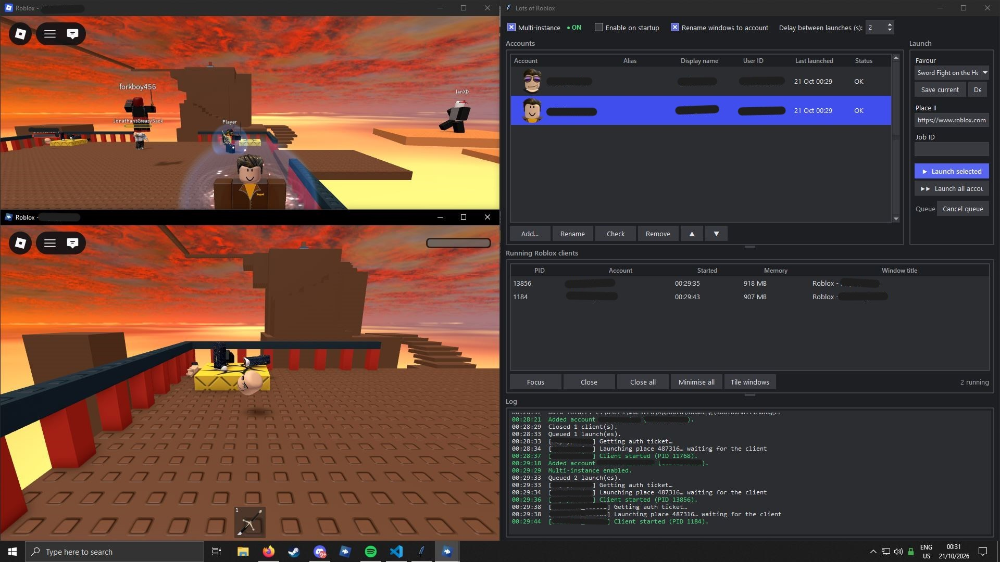

# Lots of Roblox

A small Windows app for running several Roblox clients at once, each signed in to a different account.

It's a single Python file with no dependencies beyond the standard library.

## Screenshot



## Features

- **Multi-instance** – open as many Roblox clients as you like without them closing each other
- **Saved accounts** – add accounts once and launch them with a click; avatars, display names and status shown in the list
- **Flexible launching** – join a game by place ID or link, a specific server by Job ID, or a private server (classic `privateServerLinkCode` links and newer share links)
- **Launch queue** – launch selected or all accounts one after another, with a configurable delay
- **Client overview** – see every running client with its account, start time, memory use and window title
- **Window tools** – focus, close, close all, minimise all, or tile every client in a grid
- **Window renaming** – optionally retitle each Roblox window to the account it belongs to
- **Favourites** – save games and servers you join often

## Requirements

- Windows 10 or 11
- Python 3.9 or newer (from [python.org](https://www.python.org/downloads/) – make sure Tcl/Tk is included, which it is by default)
- Roblox installed from [roblox.com/download](https://www.roblox.com/download)

## Running it

```
pythonw lots_of_roblox.py
```

Or just double-click `lots_of_roblox.py`. Using `pythonw` keeps a console window from opening alongside the app.

## Getting started

1. **Close Roblox first.** Multi-instance only works if the app starts before any Roblox client. "Multi-instance" is on by default and the indicator at the top turns green when it's active.
2. **Add an account.** Click **Add…** and paste that account's `.ROBLOSECURITY` cookie (see below). The app checks it with Roblox and fills in the username.
3. **Choose where to go.** Paste a place ID, game link or private server link into the Launch panel. Add a Job ID if you want a specific server.
4. **Launch.** Select accounts and click **Launch selected**, double-click an account, or use **Launch all accounts**.

### Getting an account's cookie

1. Open a private/incognito browser window and log in to roblox.com.
2. Open developer tools (F12) → **Application** (Chrome/Edge) or **Storage** (Firefox) → **Cookies** → `https://www.roblox.com`.
3. Copy the value of `.ROBLOSECURITY`.
4. **Close the window without logging out.** Logging out invalidates the cookie.

Repeat for each account.

## Security

The `.ROBLOSECURITY` cookie is a full login for the account, so treat it like a password.

- Cookies are encrypted with Windows DPAPI, which ties them to your Windows user account. They can't be decrypted on another PC or by another user.
- Cookies are only ever sent to Roblox's own servers (`*.roblox.com`).
- Never paste your cookie into anything you don't trust, and never share it with anyone. Anyone asking for it is trying to steal your account.

Everything is stored in `%APPDATA%\RobloxMultiManager\`:

| File | Contents |
| --- | --- |
| `data.json` | Accounts (encrypted cookies), favourites and settings |
| `avatars\` | Cached avatar headshots |

Removing an account deletes its cookie. To wipe everything, delete the folder.

## Settings

| Setting | What it does |
| --- | --- |
| Multi-instance | Allows more than one Roblox client at a time |
| Enable on startup | Turns multi-instance on automatically when the app opens |
| Rename windows to account | Retitles each client window to `Roblox - <account>` |
| Delay between launches | Seconds to wait between queued launches (0–120). Increase this if clients fail to start when launching many at once |

## Troubleshooting

**"Roblox is already running and holds the lock"**
Close every Roblox client (check the system tray too), then tick Multi-instance again. The app can close them for you.

**A new client closes the previous one**
Multi-instance is off, or Roblox was started before the app. See above.

**Account shows "Expired"**
The cookie is no longer valid, usually because you logged out or changed the password. Get a fresh cookie and add the account again; it updates the existing entry.

**"Couldn't decrypt the saved cookie"**
The data was created under a different Windows user or on another PC. Re-add the account.

**"No new client appeared within 90 s"**
Roblox may be updating. Wait for the update to finish and try again.

**Roblox reported as not installed**
The `roblox-player://` link handler isn't registered. Reinstall Roblox from roblox.com.

## Disclaimer

This project is not affiliated with, endorsed by, or associated with Roblox Corporation. Use it at your own risk and in line with Roblox's Terms of Use.
